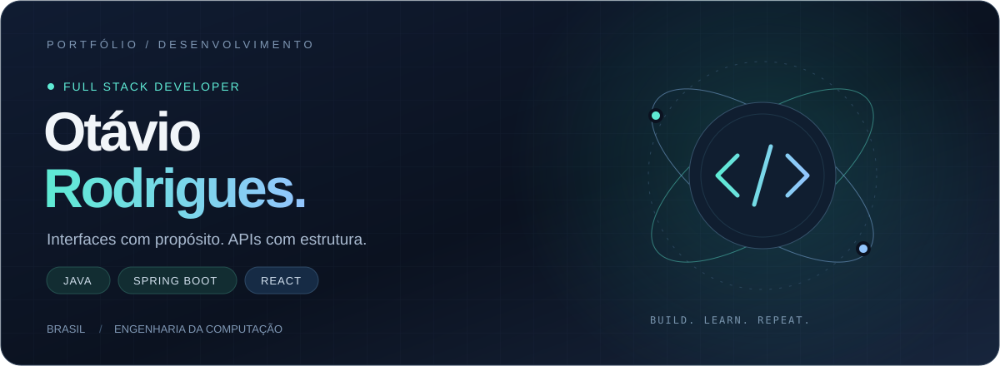
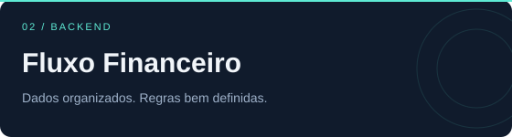
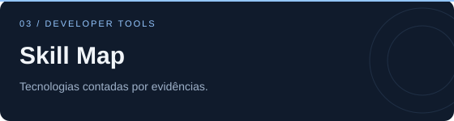
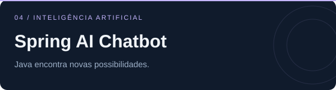

 

**Do backend à interface, construindo aplicações que conectam ideias e pessoas.**

Estudante de Engenharia da Computação · Brasil 
Java, Spring Boot e React como base. Curiosidade para ir além.

&nbsp;
&nbsp;

[Projetos em destaque](#projetos-em-destaque) &nbsp; / &nbsp; [Tecnologias](#tecnologias) &nbsp; / &nbsp; [Sobre mim](#sobre-mim)

 

## Projetos em destaque

Uma seleção do que venho construindo — de produtos para o dia a dia a APIs e ferramentas para desenvolvedores.

<table>
<tr>
<td width="50%" valign="top">

Uma agenda para profissionais de estética, com agendamento público, sincronização por conta e experiência instalável no celular.

<code>React</code> <code>TypeScript</code> <code>Firebase</code> <code>PWA</code>

<a href="https://github.com/otaviorodriguess/belahora"><b>Explorar código ↗</b></a> &nbsp; · &nbsp; <a href="https://agenda-estetica-phi.vercel.app">Conhecer aplicativo ↗</a>

</td>
<td width="50%" valign="top">

API REST para organizar receitas e despesas, calcular o saldo e gerenciar usuários com autenticação JWT.

<code>Java</code> <code>Spring Boot</code> <code>Spring Security</code> <code>PostgreSQL</code>

<a href="https://github.com/otaviorodriguess/fluxo-financeiro"><b>Explorar código ↗</b></a>

</td>
</tr>
<tr>
<td width="50%" valign="top">

Transforma sinais públicos do GitHub em um mapa de tecnologias, com radar visual, histórico e evidências por habilidade.

<code>Python</code> <code>FastAPI</code> <code>SQLAlchemy</code> <code>Docker</code>

<a href="https://github.com/otaviorodriguess/skill-map"><b>Explorar código ↗</b></a>

</td>
<td width="50%" valign="top">

Um projeto para explorar inteligência artificial em aplicações Java, integrando Spring AI e OpenAI.

<code>Java</code> <code>Spring AI</code> <code>OpenAI</code> <code>Thymeleaf</code>

<a href="https://github.com/otaviorodriguess/spring-ai-chatbot"><b>Explorar código ↗</b></a>

</td>
</tr>
</table>

<b>Mais projetos para explorar</b>

 

| Projeto | O que você encontra |
| :--- | :--- |
| [Eclipse of Eternia](https://github.com/otaviorodriguess/eclipse-of-eternia) | React, TypeScript, Phaser e Spring Boot |
| [RocketScope](https://github.com/otaviorodriguess/rocketscope-fullstack) | React, Leaflet, Spring Boot e Caffeine |
| [Event API](https://github.com/otaviorodriguess/event-api-javalin) | Java, Javalin, SQLite e Jackson |

 

## Tecnologias

 

| Área | Meu ecossistema |
| :--- | :--- |
| **Backend** | Java · Spring Boot · Spring Security · Python · FastAPI |
| **Frontend** | React · TypeScript · JavaScript · Tailwind CSS · HTML · CSS · Vite |
| **Dados** | PostgreSQL · MySQL · SQLite · Spring Data JPA · SQLAlchemy |
| **Cloud e deploy** | Firebase · Vercel · Docker · Supabase |
| **Qualidade** | Playwright · Vitest · Postman · ESLint · Prettier |
| **Ferramentas** | Git · GitHub · Linux · Maven · IntelliJ IDEA · VS Code |

 

## Sobre mim

Gosto de entender o caminho completo de uma aplicação: a experiência de quem usa, as regras de negócio e os dados que sustentam tudo.

- **Construindo:** interfaces com React e APIs com Java e Spring Boot.
- **Praticando:** código legível, separação de responsabilidades, arquitetura em camadas e APIs REST.
- **Aprendendo:** AWS e Kubernetes para ampliar minha base em infraestrutura e deploy.
- **Explorando:** inteligência artificial aplicada a produtos e ferramentas para desenvolvedores.

 

<b>Atividade no GitHub</b>

 

 

---

### Uma boa conversa pode virar um bom projeto.

[Vamos conversar no LinkedIn](https://www.linkedin.com/in/otavio-rodrigues-bezerra) &nbsp; · &nbsp; [Envie um e-mail](mailto:otaviorodriguesbezerra71@gmail.com)

Otávio Rodrigues · Java, Spring Boot &amp; React

