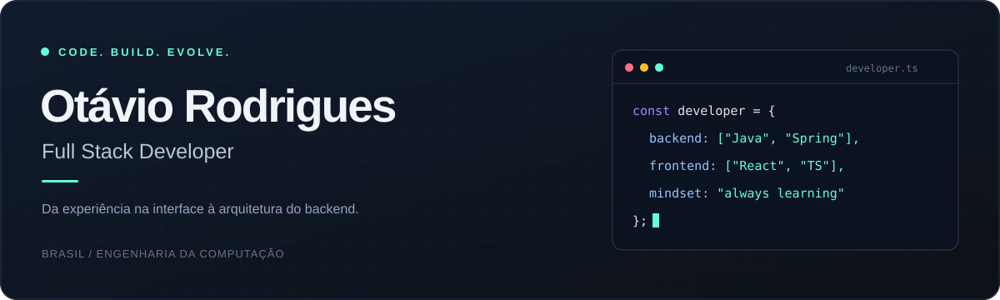

&nbsp;
&nbsp;

Construo aplicações completas com **Java, Spring Boot e React**, 
com atenção à experiência de uso, à arquitetura e à manutenção do código.

## 🧩 &nbsp; Meu ecossistema

<table>
<tr>
<td align="center" width="33%">
<h3>01 · Backend</h3>

  
<b>Java · Spring Boot · Maven</b> 
APIs REST e arquitetura em camadas
  
</td>
<td align="center" width="33%">
<h3>02 · Frontend</h3>

  
<b>React · TypeScript · JavaScript</b> 
Interfaces responsivas com HTML e CSS
  
</td>
<td align="center" width="33%">
<h3>03 · Dados</h3>

  
<b>PostgreSQL · MySQL · Supabase</b> 
Persistência e integração de dados
  
</td>
</tr>
</table>

<b>↗ Veja as ferramentas que fazem parte do meu dia a dia</b>

 

Docker · Git · GitHub · Linux · Postman · VS Code · IntelliJ IDEA

 

## 🛰️ &nbsp; Em evolução

<table>
<tr>
<td width="30%" align="center">
 

<h3>Aprendendo agora</h3>

AWS &amp; Kubernetes

</td>
<td width="70%">
<h3>Engenharia por trás do código</h3>

Busco escrever código claro, escalável e fácil de manter, aplicando princípios de engenharia de software.

<code>Clean Code</code> <code>SOLID</code> <code>POO</code>  <code>Design Patterns</code> <code>Git Flow</code>

</td>
</tr>
</table>

<b>↗ Conheça os princípios que orientam meu trabalho</b>

- **Responsabilidades claras:** separar interface, regras de negócio e persistência.
- **Arquitetura em camadas:** organizar a aplicação para facilitar sua evolução.
- **Código legível:** aplicar Clean Code e SOLID com atenção à manutenção.
- **APIs REST:** criar interfaces consistentes entre frontend e backend.
- **Versionamento:** organizar mudanças e colaboração com Git Flow.

 

## 🐍 &nbsp; Um pouco de movimento

A cobrinha continua por aqui.

 

<b>📊 Abra para explorar minha atividade no GitHub</b>

 

 

---

**Vamos transformar ideias em código?** 
[LinkedIn](https://www.linkedin.com/in/otavio-rodrigues-bezerra) &nbsp; · &nbsp; [E-mail](mailto:otaviorodriguesbezerra71@gmail.com) &nbsp; · &nbsp; [Repositórios](https://github.com/otaviorodriguess?tab=repositories)

