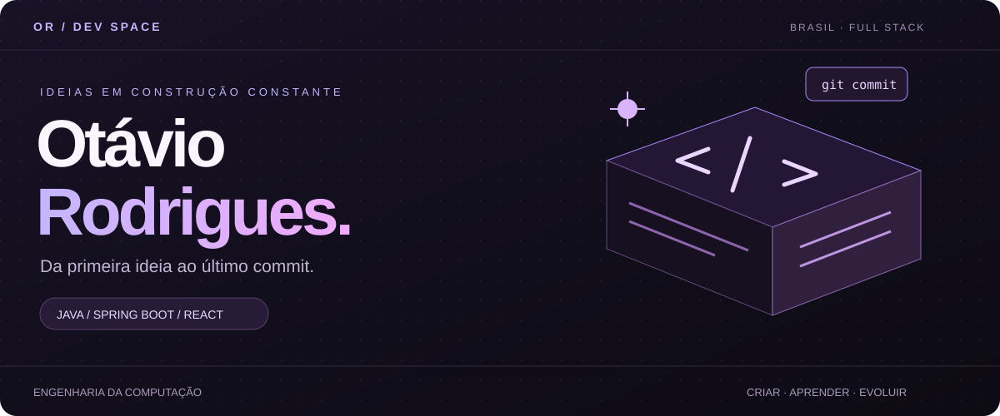
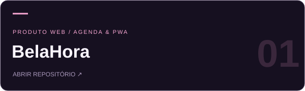
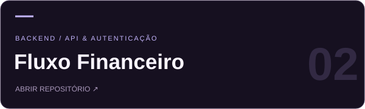
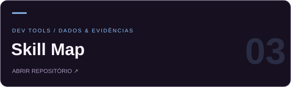
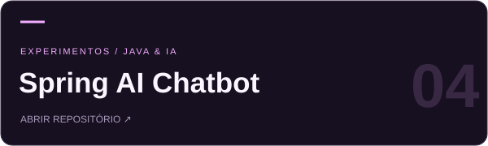
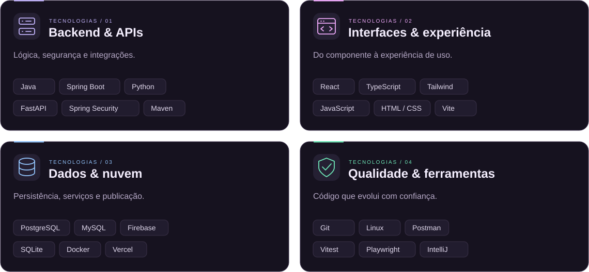
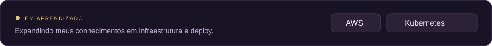
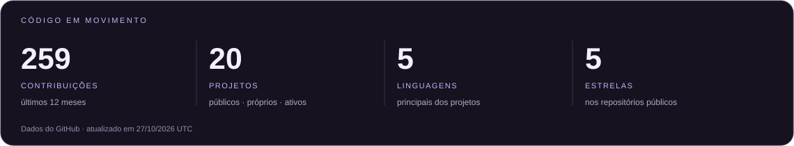
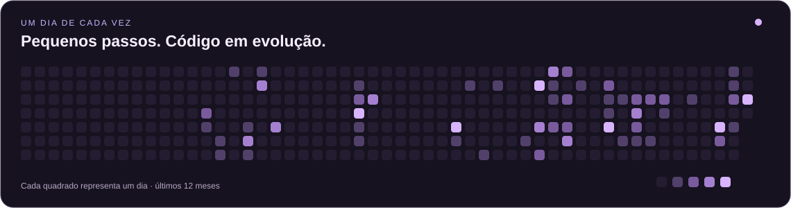
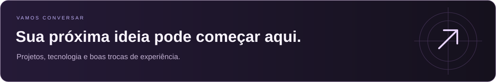

<div align="center">



<br />

<a href="#-o-desenvolvedor">◉ Sobre mim</a> &nbsp; ━ &nbsp; <a href="#-escolha-um-projeto">◈ Projetos</a> &nbsp; ━ &nbsp; <a href="#-explore-minha-stack">⌘ Stack</a> &nbsp; ━ &nbsp; <a href="#-código-em-movimento">◌ Atividade</a> &nbsp; ━ &nbsp; <a href="#-vamos-criar-algo">↗ Contato</a>

<br /><br />

**Olá, eu sou o Otávio — construo interfaces, APIs e o que conecta tudo.** 👋<br />
Estudante de Engenharia da Computação, construindo aplicações com Java, Spring Boot e React.

<br />

<a href="https://www.linkedin.com/in/otavio-rodrigues-bezerra"></a>
<a href="mailto:otaviorodriguesbezerra71@gmail.com"></a>
<a href="https://github.com/otaviorodriguess?tab=repositories"></a>

</div>

<br />

## ◉ O desenvolvedor

Gosto de conectar as peças: uma interface que faz sentido, uma API bem organizada e os dados no lugar certo. Por aqui, cada projeto é uma oportunidade de construir algo útil e aprender com o processo.

<details>
<summary><b>↳ Abrir meu arquivo de configuração</b></summary>

```yaml
nome: Otávio Rodrigues
formação: Engenharia da Computação
base: Brasil

construindo:
  - APIs REST com Java e Spring Boot
  - Interfaces com React e TypeScript
  - Produtos e ferramentas para o dia a dia

praticando:
  - Separação de responsabilidades
  - Arquitetura em camadas
  - Testes e código legível

aprendendo:
  - AWS
  - Kubernetes

explorando:
  - Inteligência artificial em aplicações
  - Novas formas de transformar ideias em software
```

</details>

<br />

## ◈ Escolha um projeto

Escolha o que você quer explorar: um aplicativo em uso, uma API, uma ferramenta para desenvolvedores ou uma integração com IA.

<table>
<tr>
<td width="50%" valign="top">
<a href="https://github.com/otaviorodriguess/belahora"></a>
<p>Uma rotina de atendimentos mais organizada, no computador ou no celular.</p><p><a href="https://agenda-estetica-phi.vercel.app"><b>▶ Experimentar o BelaHora</b></a> &nbsp; · &nbsp; <a href="https://github.com/otaviorodriguess/belahora">Código ↗</a></p>
<details>
<summary><b>↳ O que tem por dentro?</b></summary>
<p>Agenda, catálogo de serviços, agendamento público, sincronização por conta e PWA.</p>
<p><code>React</code> <code>TypeScript</code> <code>Firebase</code> <code>Vercel</code></p>
<p><a href="https://agenda-estetica-phi.vercel.app"><b>Experimentar aplicativo ↗</b></a></p>
</details>
<br />
</td>
<td width="50%" valign="top">
<a href="https://github.com/otaviorodriguess/fluxo-financeiro"></a>
<p>Receitas, despesas e saldo reunidos em uma API com autenticação JWT.</p>
<details>
<summary><b>↳ O que tem por dentro?</b></summary>
<p>Gerenciamento de usuários, registro de transações e cálculo de saldo com arquitetura em camadas.</p>
<p><code>Java</code> <code>Spring Boot</code> <code>Spring Security</code> <code>PostgreSQL</code></p>
<p><a href="https://github.com/otaviorodriguess/fluxo-financeiro#-endpoints"><b>Explorar endpoints ↗</b></a></p>
</details>
<br />
</td>
</tr>
<tr>
<td width="50%" valign="top">
<a href="https://github.com/otaviorodriguess/skill-map"></a>
<p>Um mapa de habilidades construído a partir de evidências públicas do GitHub.</p>
<details>
<summary><b>↳ O que tem por dentro?</b></summary>
<p>Radar visual, evidências por tecnologia, ranking de repositórios e histórico local de análises.</p>
<p><code>Python</code> <code>FastAPI</code> <code>SQLAlchemy</code> <code>Docker</code></p>
<p><a href="https://github.com/otaviorodriguess/skill-map#como-a-pontuação-funciona"><b>Entender a pontuação ↗</b></a></p>
</details>
<br />
</td>
<td width="50%" valign="top">
<a href="https://github.com/otaviorodriguess/spring-ai-chatbot"></a>
<p>Um espaço para explorar conversas com IA dentro do ecossistema Java.</p>
<details>
<summary><b>↳ O que tem por dentro?</b></summary>
<p>Integração de Spring AI com OpenAI e interface com Thymeleaf.</p>
<p><code>Java</code> <code>Spring AI</code> <code>OpenAI</code> <code>Thymeleaf</code></p>
<p><a href="https://github.com/otaviorodriguess/spring-ai-chatbot"><b>Conhecer o projeto ↗</b></a></p>
</details>
<br />
</td>
</tr>
</table>

<details>
<summary><b>＋ Mais caminhos para explorar</b></summary>

| Projeto | Tecnologias |
| :--- | :--- |
| [Eclipse of Eternia ↗](https://github.com/otaviorodriguess/eclipse-of-eternia) | React · TypeScript · Phaser · Spring Boot |
| [RocketScope ↗](https://github.com/otaviorodriguess/rocketscope-fullstack) | React · Leaflet · Spring Boot · Caffeine |
| [Event API ↗](https://github.com/otaviorodriguess/event-api-javalin) | Java · Javalin · SQLite · Jackson |

</details>

<br />

## ⌘ Explore minha stack

Ferramentas que uso para conectar interfaces, regras de negócio e dados.

<picture>
  <source media="(max-width: 767px)" srcset="./assets/stack-grid-mobile.svg" />
  
</picture>


<details>
<summary><b>↳ Veja como essas tecnologias se conectam nos projetos</b></summary>

| Área | Onde aplico |
| :--- | :--- |
| **Backend** | APIs REST, autenticação e regras de negócio com Spring Boot e FastAPI. |
| **Interfaces** | Componentes, formulários e experiências web com React e TypeScript. |
| **Persistência** | Spring Data JPA, SQLAlchemy, bancos relacionais e Firebase. |
| **Qualidade** | Testes com Vitest e Playwright, verificação de APIs com Postman. |
| **Outras ferramentas** | Supabase · GitHub · ESLint · Prettier · VS Code. |

[Explorar os projetos que usam essas tecnologias ↗](#-escolha-um-projeto)

</details>

<br />



<br />

## ◌ Código em movimento

Uma visão do que venho construindo e explorando no GitHub.

<!-- PROFILE:START -->


<details>
<summary><b>↳ Projetos movimentados recentemente</b></summary>

| Projeto | Linguagem principal | Último push (UTC) |
| :--- | :--- | :--- |
| [belahora ↗](https://github.com/otaviorodriguess/belahora) | TypeScript | 27/10/2026 |
| [otaviorodriguess.github.io ↗](https://github.com/otaviorodriguess/otaviorodriguess.github.io) | JavaScript | 29/09/2026 |
| [privacy-score-api ↗](https://github.com/otaviorodriguess/privacy-score-api) | Java | 30/07/2026 |
| [skill-map ↗](https://github.com/otaviorodriguess/skill-map) | Python | 26/07/2026 |

</details>

<br />

<a href="https://github.com/otaviorodriguess?tab=overview"></a>

<sub>Este painel se atualiza diariamente com GitHub Actions. As linguagens representam a linguagem principal de cada projeto, sem classificação de domínio.</sub>
<!-- PROFILE:END -->

<br />

## ↗ Vamos criar algo?



<p align="center">
<a href="https://www.linkedin.com/in/otavio-rodrigues-bezerra"></a>
<a href="mailto:otaviorodriguesbezerra71@gmail.com"></a>
<a href="https://github.com/otaviorodriguess?tab=repositories"></a>
</p>


<br />

<div align="center">
<sub>Otávio Rodrigues · Construindo, aprendendo e evoluindo.</sub><br />
<sub>Referência de organização: <a href="https://github.com/iuricode/readme-template">readme-template / Iuri Silva</a> · <a href="https://dev.to/github/10-standout-github-profile-readmes-h2o">Standout GitHub READMEs</a></sub>
</div>

